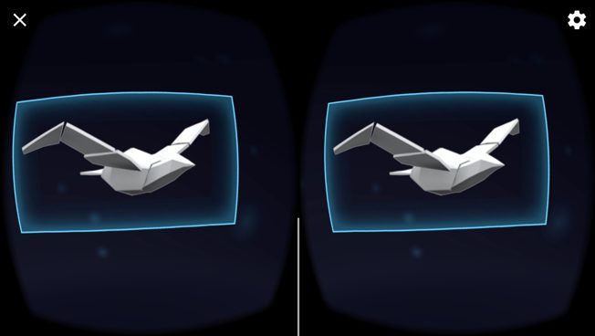
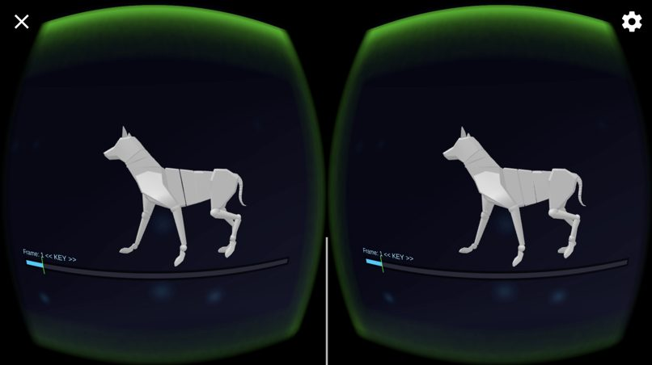
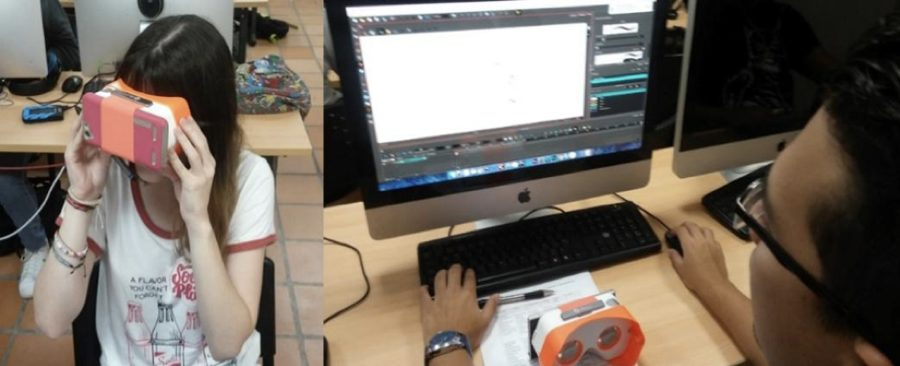
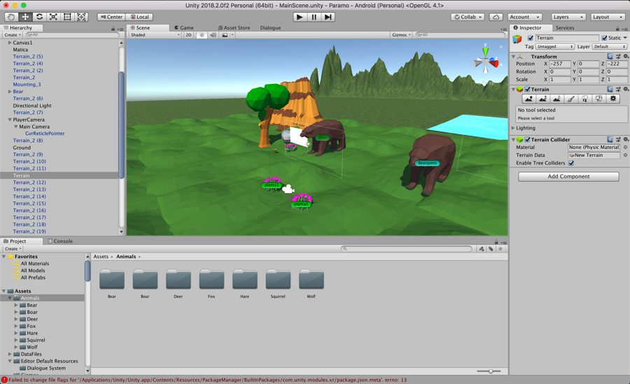

This research develops an instructional model for implementing mixed/hybrid reality in educational environments. The model is validated through two functional prototypes.

The first prototype targets higher education: it is used in an animation class of the audiovisual arts programme and lets students modify and build kinetic structures in virtual reality using Google Cardboard.

  
  
  

The second prototype focuses on teaching ecosystems in primary school: an open world where students explore and complete missions in order to learn new concepts.

  

