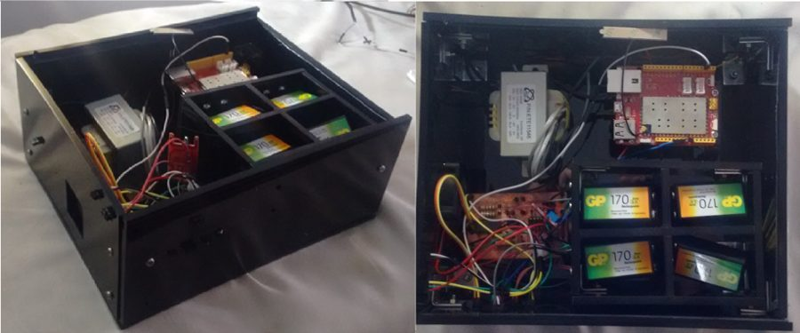
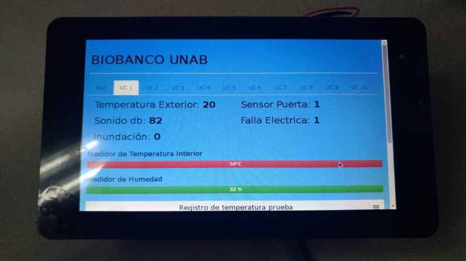
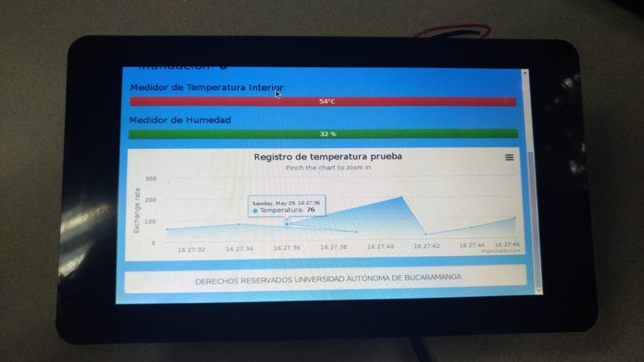

A biobank is a repository that stores and manages biological samples (biospecimens) for research. Correct handling, organisation and storage are essential to its purpose, and storage conditions such as humidity and temperature are critical: if these parameters fluctuate without an adequate control plan, biological material of high scientific value is put at risk.

We built a low-cost remote monitoring system for the UNAB biobank using open-source hardware and software. It monitors temperature, humidity, door opening, alarms and power failures using environmental sensors, a custom-built microcontroller and a Raspberry Pi, plus a web interface that helps the biobank staff follow the storage conditions.

  
  
  

