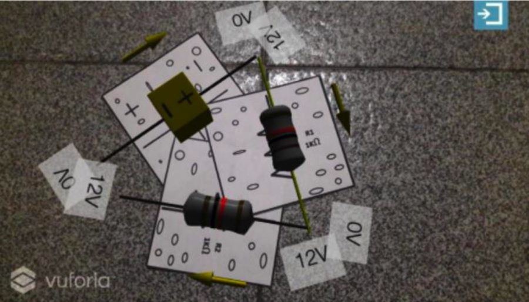
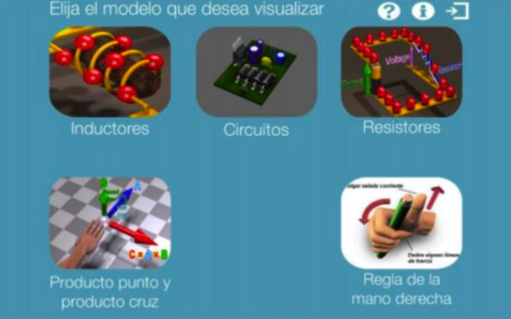

The main motivation of this research is university dropout. First-semester students sometimes arrive with gaps in concepts studied in high school; together with the way mathematics, physics and chemistry courses are taught, this can make them lose interest in these courses, leading to low academic performance and, eventually, dropout.

We developed an augmented reality application that any teacher and student at the Universidad Autónoma de Bucaramanga (UNAB) can use as a complement to their classes, to capture students' interest and make it easier to grasp the concepts studied. This version focuses on electromagnetic concepts: resistors, circuits and magnetic fields. With EducAR, physical phenomena and experiments can be represented with 3D models without additional lab equipment.

EducAR was built with Unity 3D (version 5.3.1), which targets both mobile and desktop devices, and the Vuforia SDK, which turns the device screen into an augmented reality display.

  
  

> Good company in a journey makes the way seem shorter. — Izaak Walton
