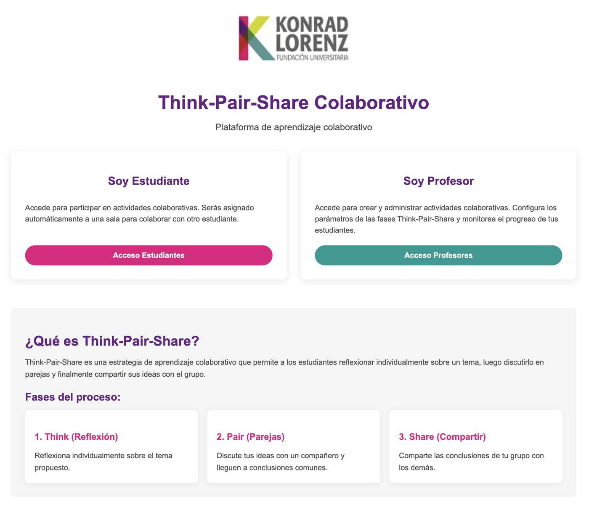
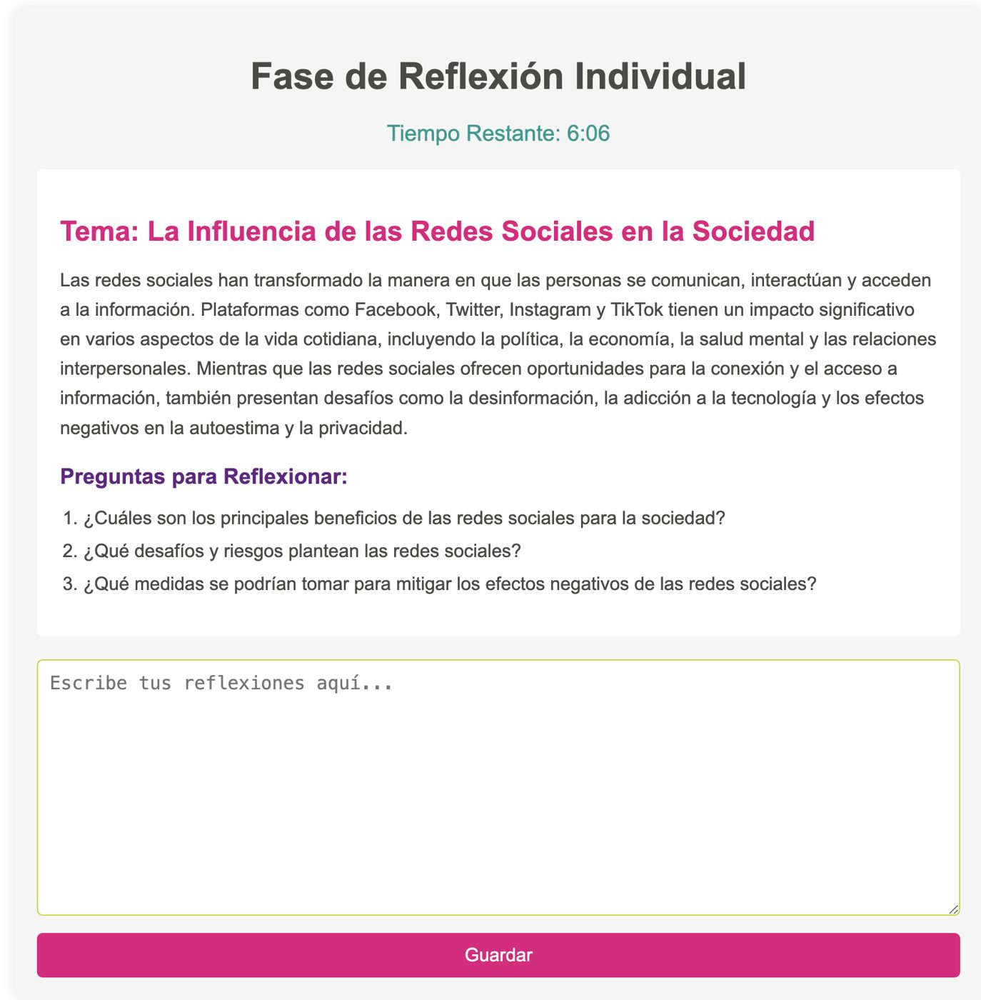
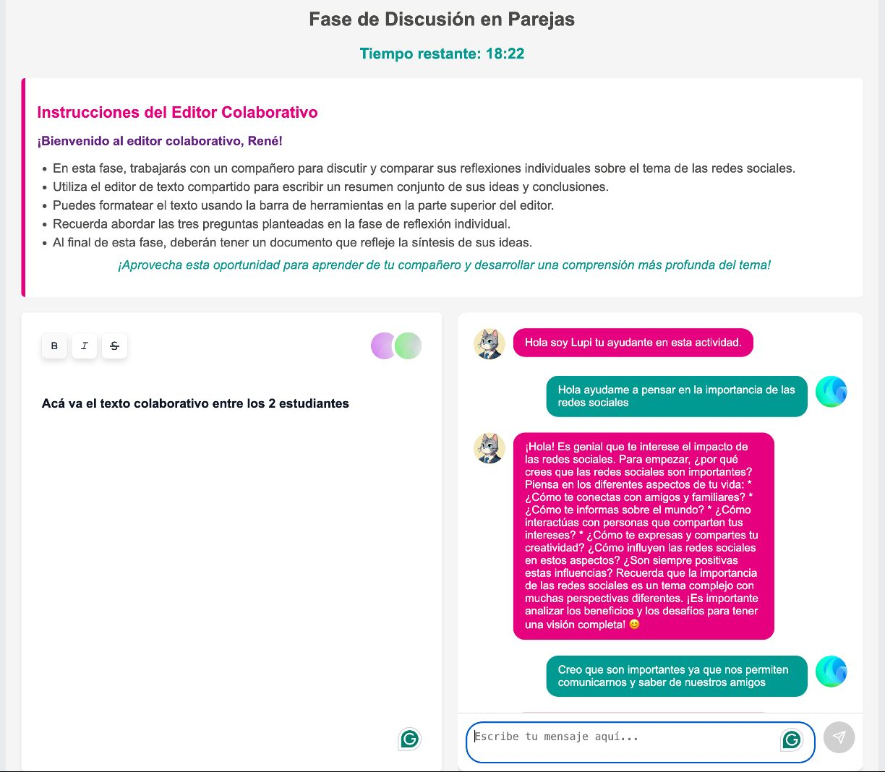
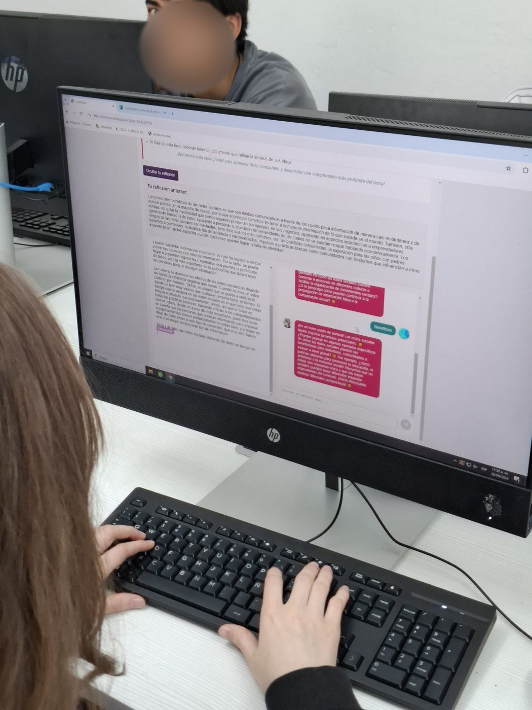
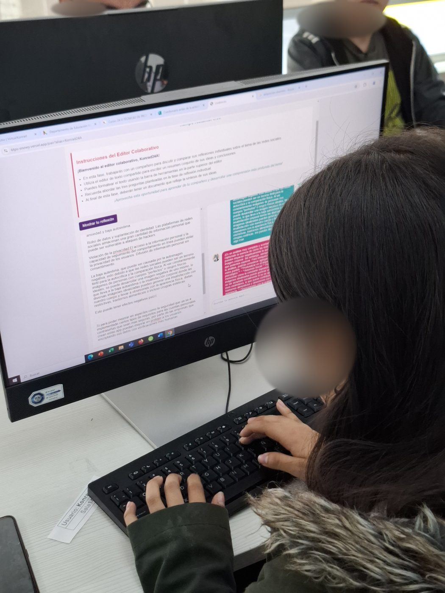

Konrad Think-Pair-Share is a collaborative learning platform I developed at Fundación Universitaria Konrad Lorenz to study how artificial intelligence can be integrated into the Think-Pair-Share (TPS) methodology, and how learning analytics can measure its effect on students' creative thinking.

## The platform

A custom web platform with real-time synchronisation and built-in learning analytics, following the three TPS phases:

- **Think (8 min):** each student reflects and writes individually in a private workspace.
- **Pair (20 min):** anonymous pairs write together in a synchronised editor. In the AI-enhanced version, both students can consult a Google Gemini-powered chatbot, *Lupi*, instructed to help them reflect on the topic *without giving direct answers*, by asking questions, suggesting other perspectives and giving feedback on structure and clarity.
- **Share (15 min):** pairs present and discuss their conclusions with the whole class.

The platform logs every writing interaction, the final texts and the full student–chatbot dialogues for analysis.

  
  
  

Teachers create and manage the activities, configure the parameters of each Think-Pair-Share phase and monitor their students' progress; students are automatically assigned to a room with a partner.

## The study

A cluster-randomised quasi-experimental study with **140 Systems Engineering students** in seven classes (Programming Fundamentals, Software Analysis and Design, and Software Engineering): 80 students used the AI-enhanced platform and 60 used the same platform without AI. Linguistic creativity was analysed along four dimensions (fluency, flexibility, originality and elaboration) using lexical diversity (TTR, MTLD), topic modelling, productivity metrics and the similarity between students' texts and the chatbot's responses.

  
  

## Findings

- The best results came from **moderate integration** of the AI suggestions (similarity of 0.3–0.7 with the chatbot's responses), which 70% of participants achieved.
- The AI-supported group showed **30–37% productivity gains** and a **99% increase in thematic diversity**, with moderate lexical standardisation effects.
- For practice: include an individual reflection phase before AI-supported writing, design AI support that promotes linguistic diversity while preserving students' creative autonomy, and avoid relying on length-sensitive metrics such as TTR when assessing creative outcomes.

Read the full article, published open access in the *Journal of Learning Analytics*: [AI-Enhanced Think-Pair-Share: A Learning Analytics Approach to Foster Linguistic Creative Thinking and Collaborative Learning](https://doi.org/10.18608/jla.2025.8807).
