Mobile application development is one of my favourite things in engineering. Since 2013 I have designed and developed several Android and cross-platform apps; some of them are shown below.

## Transpórtate

Transpórtate helps citizens find their way inside Bogotá's public transport system, showing the best route and the expected travel time to their destination. To improve the user experience we added a competitive game: users choose a tribe and earn points and promotions by using the app.

  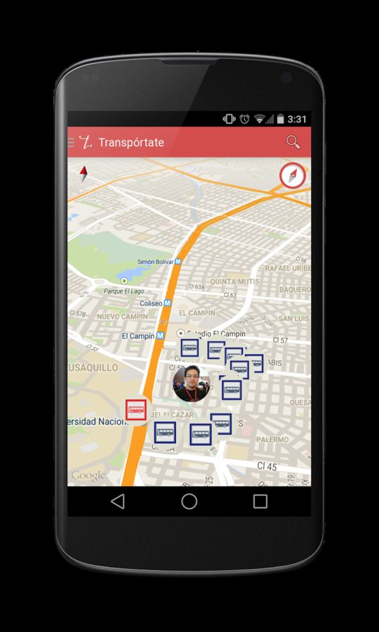
  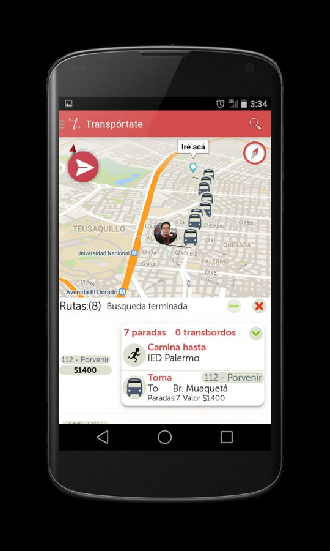
  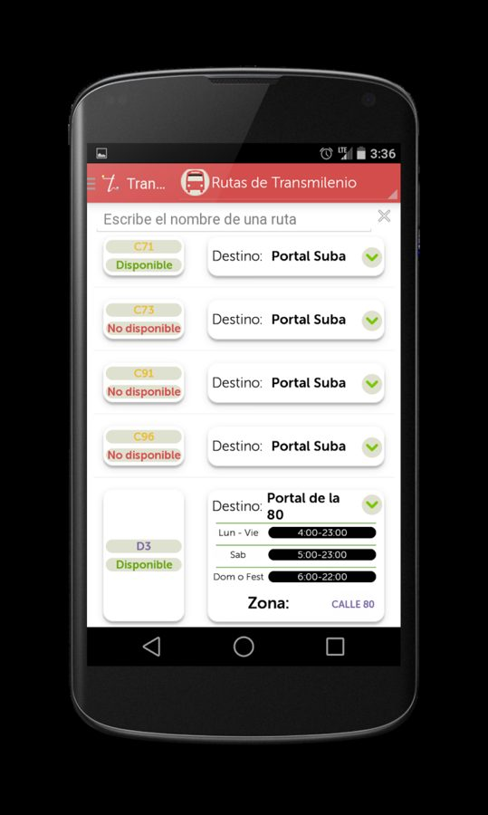

## Learn Russian

An easy-to-use mobile learning app for people starting to learn Russian:

- Russian (Cyrillic) alphabet with pronunciation and examples
- Common and useful phrases
- Basic vocabulary with flashcards

  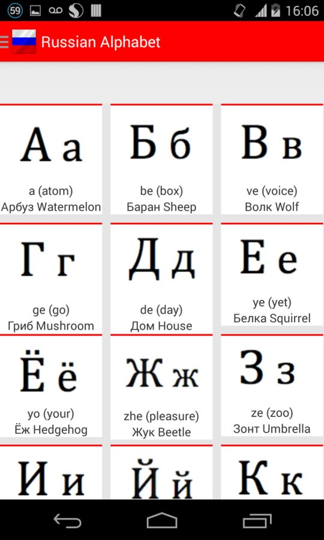
  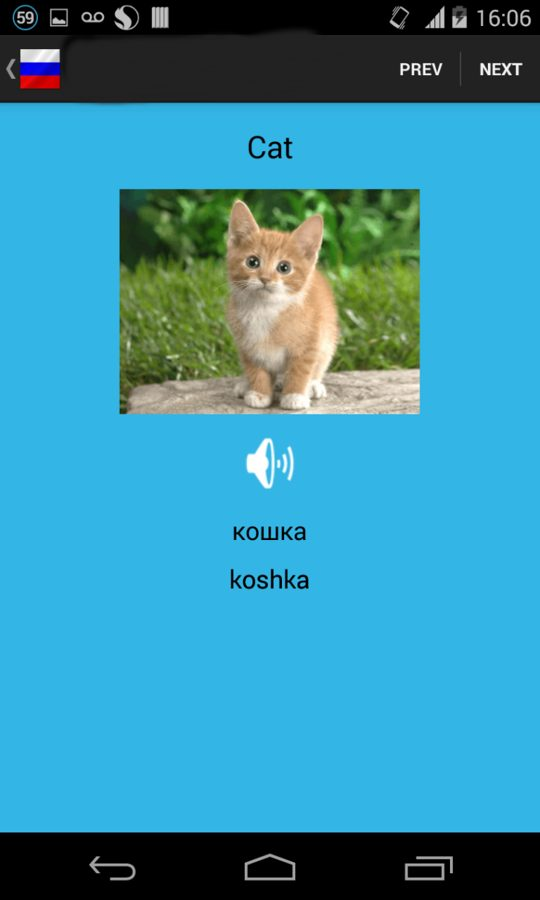
  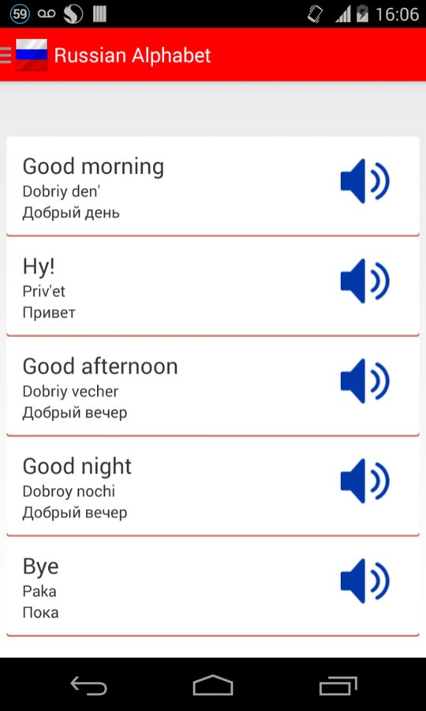

## Domi

*What you want, from the places you like.* Domi changed the way things are delivered around the city: it buys, collects and delivers anything you want, within minutes.

  
  
  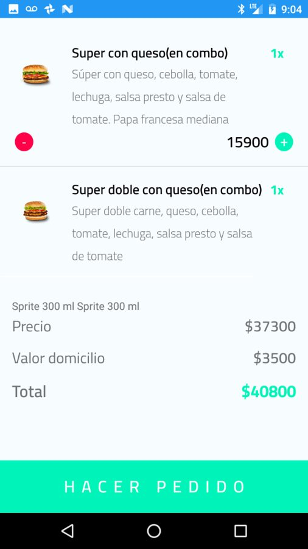
  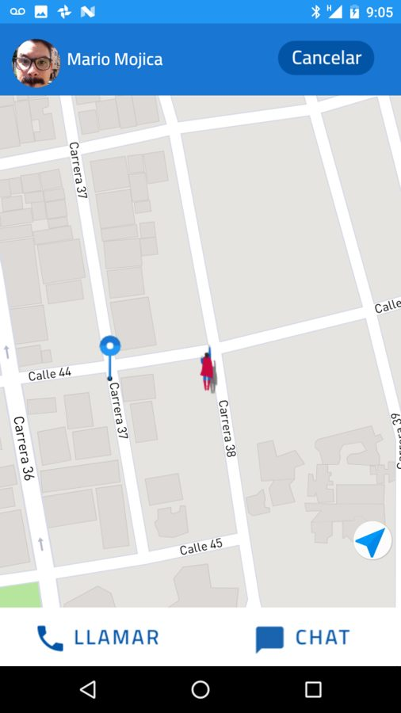
  

## Dingo

Dingo connects passengers with taxi drivers: request a ride from your smartphone, verify the driver's information, travel and rate the trip.

  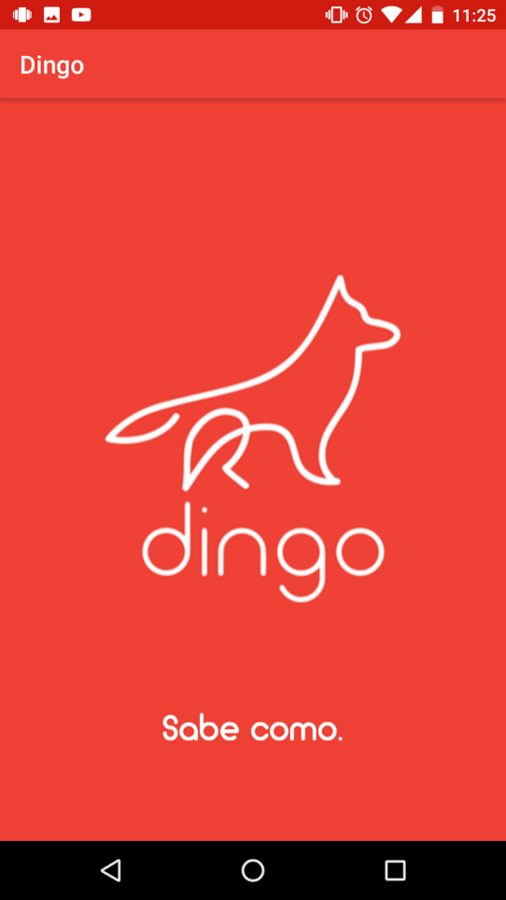
  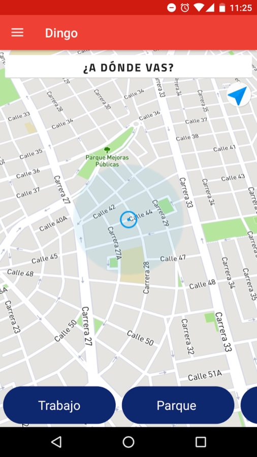
  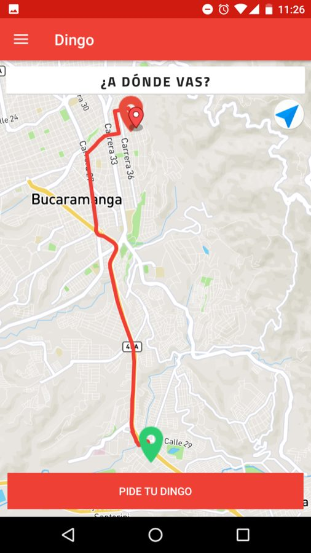
  

## Semovil student group

With Semovil, the student group I coordinated at the Universidad Autónoma de Bucaramanga (UNAB), students learned to build Android applications following good software engineering and design practices, and developed several apps to help the university community. The apps are listed on [Google Play](https://play.google.com/store/apps/collection/cluster?clp=igM0ChkKEzU5NjAwMzkwMDU0NjEzOTQ5NDkQCBgDEhUKD2NvbS50aXJvaWRlc2FwcBABGAMYAQ%3D%3D:S:ANO1ljIHWGM).
